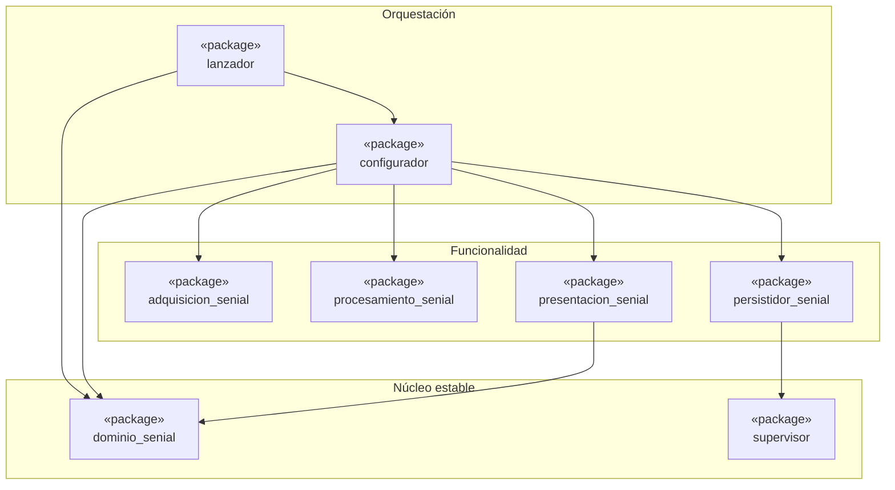

# Diagrama de paquetes

Dependencias reales entre paquetes, derivadas de los `import` del código (estado `main`, V10 DIP).
Una flecha `A --> B` significa "A importa de B".

## Qué mostrar en clase

- `dominio_senial` y `supervisor` no dependen de nadie: son el núcleo estable.
- `adquisicion_senial` y `procesamiento_senial` tampoco dependen de nadie; solo `configurador` los conoce.
- `lanzador` no importa ningún paquete concreto de adquisición, procesamiento ni persistencia: eso es DIP.
- Todas las flechas apuntan hacia el núcleo (sin ciclos).
