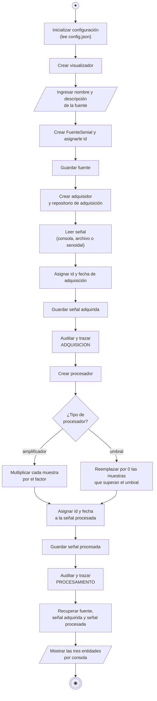

# Diagrama de actividad

Flujo de `Lanzador.ejecutar()` (`lanzador/lanzador.py`).

## Notas

- El procesador drena la señal de entrada (`sacar_valor` hasta que `cantidad` es 0). Por eso la señal adquirida se guarda **antes** de procesar, y la que se muestra al final es la recuperada de disco.
- Con el adquisidor `consola` hay una iteración extra por muestra (leer y validar); con `archivo` se ignoran las líneas que no son números.
