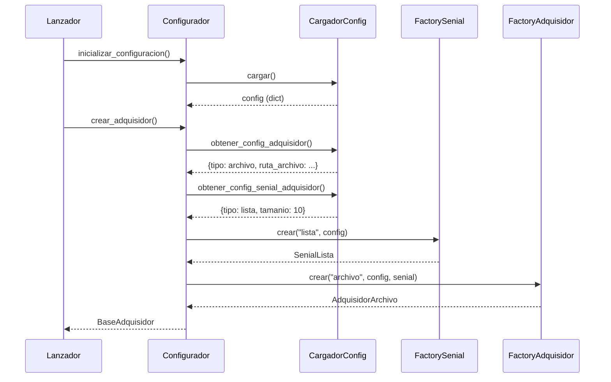
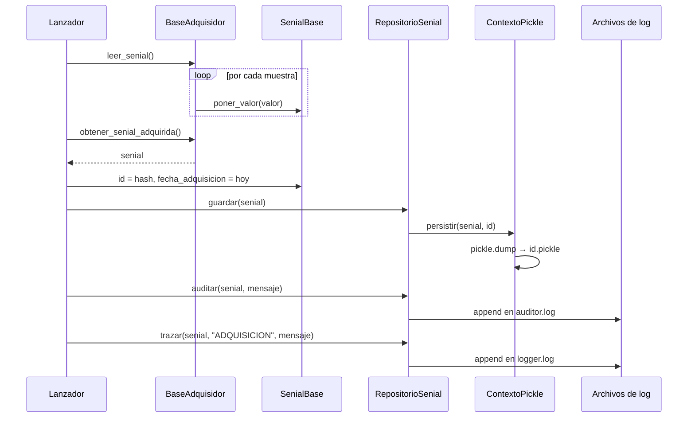
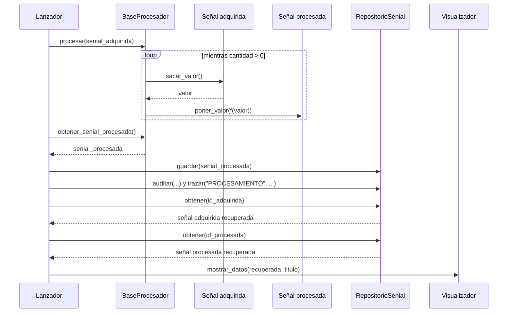

# Diagramas de secuencia

## 1. Creación de dependencias (DIP)

Qué pasa cuando el `Lanzador` pide un adquisidor. Él no conoce ningún tipo concreto: lo resuelve el `Configurador` con config.json y los factories.

## 2. Adquisición y persistencia de la señal

Primera mitad del pipeline: leer, guardar, auditar y trazar.

## 3. Procesamiento y recuperación

Segunda mitad: procesar, guardar y volver a leer de disco para mostrar.

