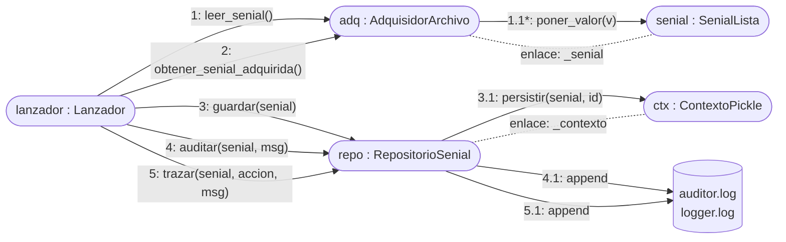

# Diagrama de colaboración (comunicación en UML 2)

Mermaid no tiene un tipo de diagrama de comunicación. Se representa con un diagrama de objetos enlazados y **mensajes numerados**, que es la característica distintiva del diagrama de comunicación frente al de secuencia: se enfatiza la estructura de enlaces, no el eje temporal.

Escenario: guardar la señal adquirida y registrar auditoría y traza (misma situación que el diagrama de secuencia 2).

## Lectura

- `1.1*` indica iteración: se repite por cada muestra.
- Los enlaces punteados son relaciones de la estructura (el adquisidor conoce su señal; el repositorio conoce su contexto). Los inyecta el `Configurador`.
- La numeración decimal (`3`, `3.1`) expresa anidamiento: `3.1` ocurre dentro de la ejecución de `3`.
