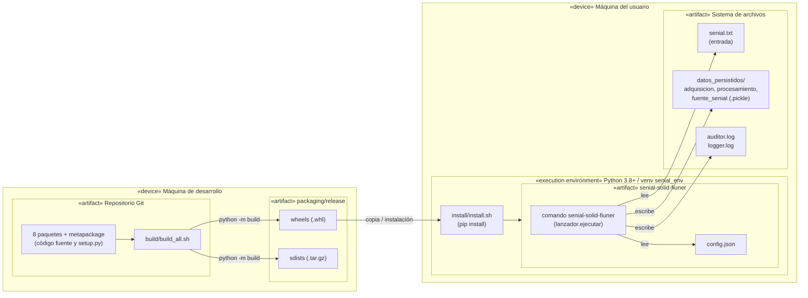

# Diagrama de despliegue

El sistema es una aplicación local de un solo nodo. El diagrama muestra el ciclo completo: build en la máquina de desarrollo, release como artefactos, instalación y ejecución con los archivos que se generan.

## Notas

- No hay servidores, red ni base de datos: la «persistencia» es el sistema de archivos local.
- Los contextos de persistencia (`pickle` o `archivo`) y las rutas se eligen en `config.json`; el diagrama muestra la configuración por defecto.
- Los logs se escriben en el directorio desde el que se ejecuta el comando.
