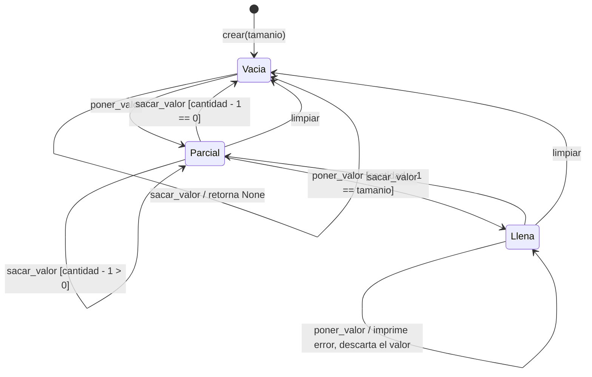
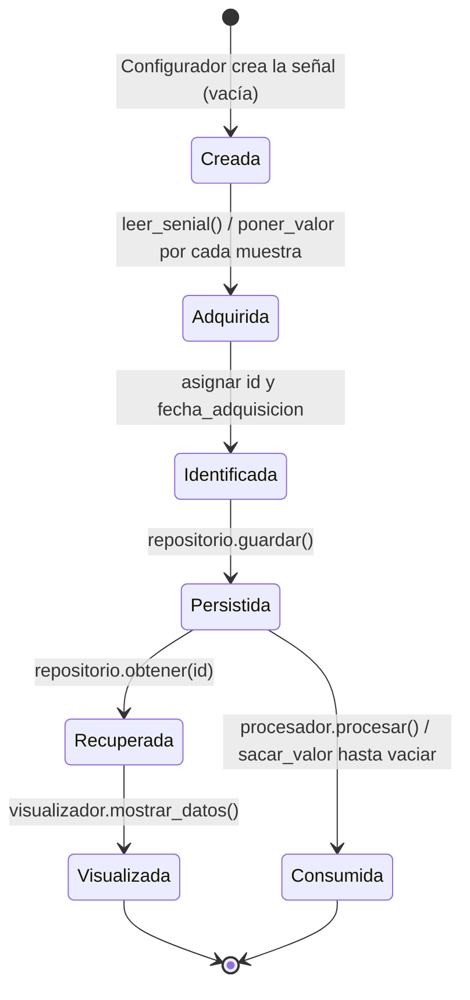

# Diagramas de estado

## 1. Una señal con capacidad acotada (`SenialPila` / `SenialCola`)

Estados derivados de `cantidad` frente a `tamanio` (`dominio_senial/senial.py`).

Con `tamanio = 1`, `Vacia` pasa directo a `Llena`.

## 2. Ciclo de vida de una señal dentro del pipeline

## Notas

- En el diagrama 2, la señal original queda **vacía en memoria** después de procesar (estado `Consumida`); lo que se muestra al final es la copia recuperada de disco.
- La señal procesada recorre el mismo ciclo desde `Creada`, y se llena con `poner_valor` desde el procesador.
- El `Lanzador` asigna el `id` y la fecha **antes** de guardar, así que el estado `Identificada` es una condición previa de la persistencia.
