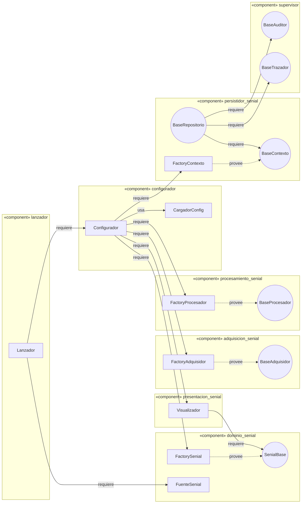

# Diagrama de componentes

Cada paquete instalable (tiene su propio `setup.py`) es un componente. Se muestran las **interfaces provistas** (contratos abstractos) y las **requeridas**.

Mermaid no tiene diagrama de componentes nativo: se representa con subgrafos «component» e interfaces como nodos circulares.

## Qué mostrar en clase

- Las dependencias entre componentes pasan por **interfaces** (círculos), no por clases concretas: DIP.
- `persistidor_senial` requiere las dos interfaces pequeñas de `supervisor` (`BaseAuditor`, `BaseTrazador`) en lugar de una interfaz grande única: ISP.
- Agregar un tipo nuevo (por ejemplo un procesador) solo toca el componente que lo contiene y su factory: OCP.
- Solo `configurador` conoce a todos los demás componentes: es el punto único de ensamblado.
